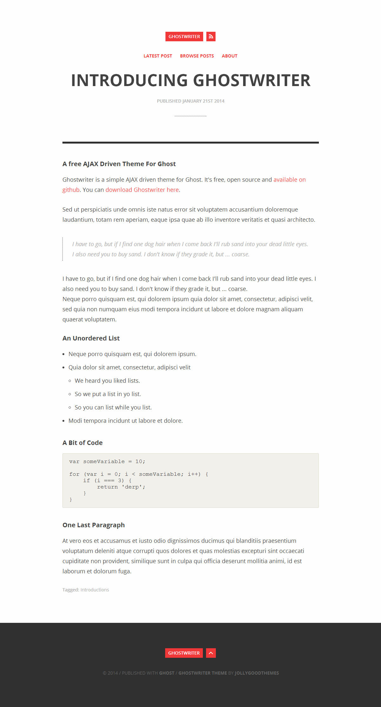

# Ghostwriter

一个排版很干净的 [Ghost](https://github.com/tryghost/ghost) 主题，已修改为兼容 Ghost 6 的版本。

演示：<https://blog.mout.me/>

仓库：<https://github.com/chasekafei/Ghostwriter>



## 特性

- 兼容 Ghost 6，通过 gscan 检查。
- 还是原来的样子：窄正文栏、红黑配色。首页先放最新一篇，点 Browse Posts 再看文章列表。
- 桌面右侧有边栏，屏幕小的时候会收起来。
- 文章、页面、标签、作者页都能用，也支持特色文章。
- 编辑器里的宽幅、全宽卡片可以正常显示。
- 评论可以在后台选 Ghost、Gitalk 或 Remark42，默认不加载。搜索用的是 Ghost 自带的。
- 原版是针对英文排版的主题，我重新针对中文做了字体和排版的优化。

## 配置项

通过配置项来控制主题上的部分内容展示。
1. 选择评论服务及参数：Ghost 自带评论 / Gitalk / Remark
2. 配置侧边栏数据：社媒、好友、友链等

配置方法：

在 Ghost 后台打开当前主题的设置。侧边栏相关的字段在全站一组，评论在文章一组。留空的项目不会显示。

- 社交链接：直接填写完整网址：`sidebar_twitter`、`sidebar_instagram`、`sidebar_weibo`、`sidebar_steam`。
- Friends 和 Links：每个名字和网址为一组，每组之间用 `;;` 隔开，名字和网址之间用 `|` 隔开，分隔符两侧不要加空格。示例：

```text
MouT.me|https://example.com/;;Jeremy|https://example.org/
```

名字或网址里不要再出现 `;;` 或 `|`。

## 原作者

主题最早是 Rory Gibson 写的，仓库在 [roryg/ghostwriter](https://github.com/roryg/ghostwriter)，许可证是 MIT。这里是在那个版本上改的，`LICENSE.txt` 里仍然留着他的版权声明。

## 一些题外话

我一直非常喜欢这个主题，设计简洁，视觉鲜明，用色克制。我从 Ghost 1 开始用，到 Ghost 2 出现了兼容问题之后，自己做了修改又接着用了很多很多年。

今天更新 Ghost 发现已经到 Ghost 6 了，这套主题已经完全无法兼容了。本来觉得可惜，但看到它是 MIT License，于是动手改了一版，让它能在 Ghost 6 上继续用。

原来的主题其实很独特，在当年几乎是唯一的靠 Ajax 实现的“单页面”主题。配合着加载时顶部的红色进度条，十分“优雅”。

后来我自用的时候，参考 Hexo 的一个很喜欢的主题，加了现在的这个侧边栏。

但可惜的是，Ajax 确实很过时了，而且在 Ghost 6 中无刷新跳转会造成一些新功能（评论、搜索、会员）出问题，所以不得不拿掉了，改成比较传统的整页打开。但整体的设计和交互依然保留了下来。

好了，废话结束。

只是希望这个主题还能被喜欢的人接着用下去。

## 许可证

[MIT](LICENSE.txt)
